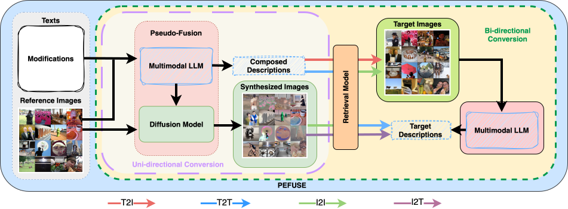

# PEFUSE: Training-Free Pseudo-Fusion for Composed Image Retrieval with Diffusion Models and Multimodal Large Language Models

This repository contains **PEFUSE (PeFuse in the paper)**, a training-free framework for **composed image retrieval (CIR)**. Given a reference image and a textual modification, PeFuse uses pretrained generative models to create a single image or text query, then ranks candidate images by cosine similarity in a pretrained retrieval model's embedding space. No CIR-specific training or fine-tuning is required.

**[`retrieval.py`](retrieval.py) is the main entry point for the paper's experiments.** Start with the CIRCO validation example below. Some evaluation branches have implementation limitations; see [Known limitations](#known-limitations) before running them.

[Paper (arXiv)](https://arxiv.org/abs/2608.23102) · [Publication (TMLR / OpenReview)](https://openreview.net/forum?id=6W3pFEQXZc)

## Contents

- [Proposed framework](#proposed-framework)
- [Installation](#installation)
- [Datasets and configuration](#datasets-and-configuration)
- [Running experiments](#running-experiments)
- [Command-line options](#command-line-options)
- [Results and outputs](#results-and-outputs)
- [Known limitations](#known-limitations)
- [Repository guide](#repository-guide)
- [Citation](#citation)

## Proposed Framework



PeFuse converts CIR into four retrieval tasks. The task name describes the **generated query modality** and the **candidate representation**:

| Paper notation | `--task` | Query representation | Candidate representation | Conversion |
| --- | --- | --- | --- | --- |
| T→I | `txt2img` | MLLM-generated composed description | Original image | Uni-directional |
| I→I | `img2img` | Diffusion-generated image | Original image | Uni-directional |
| T→T | `txt2txt` | MLLM-generated composed description | MLLM-generated image description | Bi-directional |
| I→T | `img2txt` | Diffusion-generated image | MLLM-generated image description | Bi-directional |

For image-query tasks, `--use_mllm yes` refines the modification into a composed description before image generation; `--use_mllm no` passes the original modification directly to the diffusion model. The paper finds T→I to be the most effective conversion strategy overall.

## Installation

### Environment

Use a Linux machine with an NVIDIA CUDA GPU. The paper uses a **single NVIDIA A100 with 40 GB memory**. Memory requirements vary with model, task, and batch size; image generation loads both a diffusion model and an MLLM. The script calls CUDA functions directly, so CPU-only and Apple Silicon execution are not supported as written.

Python 3.11 is a practical starting point, matching the Python version referenced in `submit.sh`.

```bash
git clone https://github.com/StevenXuf/PeFuse4CIR.git
cd PeFuse4CIR
python3.11 -m venv .venv
source .venv/bin/activate
python -m pip install --upgrade pip
```

SSH cloning is also available with `git clone git@github.com:StevenXuf/PeFuse4CIR.git` if your GitHub SSH key is configured.

### Dependencies

[`requirements.txt`](requirements.txt) records the broader research environment, including packages outside the main retrieval pipeline and CUDA-specific dependencies. For the main script, the following focused installation uses versions from that file. It is not a complete environment lockfile.

Install CUDA-enabled PyTorch first. This example uses CUDA 12.6 wheels; choose a build compatible with your NVIDIA driver using the [official PyTorch installation commands](https://pytorch.org/get-started/previous-versions/#v271).

```bash
python -m pip install torch==2.7.1 torchvision==0.22.1 \
  --index-url https://download.pytorch.org/whl/cu126

python -m pip install \
  transformers==4.53.2 diffusers==0.34.0 accelerate==1.10.0 \
  open_clip_torch==3.1.0 torchmetrics==1.8.0 qwen-vl-utils==0.0.8 \
  fire==0.7.0 PyYAML==6.0.2 omegaconf==2.3.0 \
  numpy==2.2.6 pillow==11.3.0 matplotlib==3.10.3 tqdm==4.67.1 \
  datasets==3.6.0 requests==2.32.4 sentencepiece==0.2.0 \
  safetensors==0.5.3
```

Image-query tasks (`img2img`, `img2txt`) also require xFormers because the script enables its memory-efficient attention unconditionally:

```bash
python -m pip install xformers==0.0.31
python -m pip check
```

Check CUDA availability before starting an experiment:

```bash
python -c 'import torch; print("PyTorch:", torch.__version__); print("CUDA:", torch.cuda.is_available()); assert torch.cuda.is_available(); print("GPU:", torch.cuda.get_device_name(0))'
```

Model weights and processors are downloaded on first use through Hugging Face / OpenCLIP. Allow network access and enough disk space for their caches. Dataset images and annotations must be downloaded separately.

## Datasets and Configuration

Run commands from the repository root: the code reads **`config.yaml` from the current working directory**, and does not expose a `--config` option.

### Prepare the data

| Dataset | Download instructions | Dataset selector | Evaluation |
| --- | --- | --- | --- |
| CIRCO | [Official repository](https://github.com/miccunifi/CIRCO) | `--dataset CIRCO` | `val`: local mAP; `test`: prediction JSON for server evaluation |
| CIRR | [Official repository](https://github.com/Cuberick-Orion/CIRR) | `--dataset CIRR` | `val`: local recall; `test`: full-gallery and subset prediction JSON |
| Fashion-IQ | [Official repository](https://github.com/XiaoxiaoGuo/fashion-iq) | `--dataset FashionIQ` | `val`: recall for shirt, dress, and toptee |
| GeneCIS | [Official download instructions](https://github.com/facebookresearch/genecis/blob/main/DOWNLOAD.md) | `focus_attribute`, `change_attribute`, `focus_object`, `change_object` | Local recall within each query's candidate set |

Only download the datasets needed for your experiment. The layouts expected by the loaders are:

```text
CIRCO/                              # CIRCO.IMAGE_FOLDER
├── annotations/
│   ├── val.json
│   └── test.json
└── COCO2017_unlabeled/
    ├── annotations/image_info_unlabeled2017.json
    └── unlabeled2017/<12-digit-image-id>.jpg

CIRR/                               # CIRR.IMAGE_FOLDER
├── captions/cap.rc2.<split>.json
├── captions_ext/cap.ext.rc2.<split>.json
├── image_splits/split.rc2.test1.json
└── img_raw/
    ├── dev/<image-id>.png
    ├── test1/<image-id>.png
    └── train/<subfolder>/<image-id>.png

FashionIQ/                          # FashionIQ.IMAGE_FOLDER
├── images/<image-id>.jpg
├── captions/cap.<category>.val.json
└── image_splits/split.<category>.val.json

genecis/                            # GeneCIS.GENECIS_ROOT
├── focus_attribute.json
├── change_attribute.json
├── focus_object.json
└── change_object.json
```

For CIRR, `<split>` is `val` or `test1` for the evaluation examples. Pass **`--split test`** on the command line; the dataset class maps it to `test1`. Both regular and extended captions are required, and the loader combines them into the query modification.

Fashion-IQ needs all three categories (`shirt`, `dress`, `toptee`). Its loader filters out queries and candidates with missing images, so check the printed counts when comparing results with the paper. The default `FashionIQ.IMAGE_FOLDER` points to a directory named `RefinedFashionIQ`; this loader still expects the standard Fashion-IQ captions and image splits shown above.

GeneCIS needs Visual Genome images for attribute tasks and COCO 2017 validation images for object tasks. **The current loaders hard-code their image locations** to `/data/data_fxu/GeneCIS/VG_100K` and `/data/data_fxu/COCO/images/val2017`. Setting `GeneCIS.VG_FOLDER` or `GeneCIS.COCO_FOLDER` in YAML does not override these locations. To use the unchanged loaders, place or symlink the images at those paths. `GeneCIS.GENECIS_ROOT` does control the location of the four JSON files.

### Set local paths

The checked-in configuration uses `/data/data_fxu/...` paths. Before running, update the relevant values in your local `config.yaml` to point to the downloaded data and writable output directories. For example, replace these values in their existing sections:

```yaml
CIRCO:
    IMAGE_FOLDER: '/absolute/path/to/CIRCO'
CIRR:
    IMAGE_FOLDER: '/absolute/path/to/CIRR'
FashionIQ:
    IMAGE_FOLDER: '/absolute/path/to/FashionIQ'
GeneCIS:
    GENECIS_ROOT: '/absolute/path/to/genecis'

IMAGE-GENERATION:
    SDXL-INSTRUCTPIX2PIX:
        OUTPUT_DIR: '/absolute/path/to/outputs/sdxl_instructpix2pix'
    SDXL-TURBO:
        OUTPUT_DIR: '/absolute/path/to/outputs/sdxl_turbo'
```

This is a **path-editing example, not a replacement configuration**: retain the other settings in each section. CLI arguments override the corresponding experiment settings, but dataset roots and output directories are read from YAML. `GENERAL.NUM_WORKERS` also comes from YAML.

## Running Experiments

### Start here: CIRCO validation, text-to-image

After installing dependencies and setting `CIRCO.IMAGE_FOLDER`, run:

```bash
CUDA_VISIBLE_DEVICES=0 python -u retrieval.py \
  --dataset CIRCO --split val --task txt2img \
  --extractor OPENCLIP --mllm QWEN-7B \
  --batch_size 8 --seed 42 \
  --temperature 0.1 --top_p 0.9 --llm_top_k 50 --max_new_tokens 128 \
  --top_k '[1,5,10,25,50]' \
  2>&1 | tee circo_val_txt2img.log
```

This generates composed query descriptions with Qwen2.5-VL-7B, extracts OpenCLIP features, and prints mAP at the requested cutoffs. It does not load a diffusion model. The current `config.yaml` defaults to `img2img`, so specify `--task txt2img` explicitly for this example.

### CIRCO validation, image-to-image

Use the paper's SDXL-InstructPix2Pix settings:

```bash
CUDA_VISIBLE_DEVICES=0 python -u retrieval.py \
  --dataset CIRCO --split val --task img2img \
  --extractor OPENCLIP --mllm QWEN-7B --use_mllm yes \
  --image_gen_model SDXL-INSTRUCTPIX2PIX \
  --n_infer_steps 30 --image_guidance_scale 3.0 --guidance_scale 7.5 \
  --batch_size 8 --seed 42 \
  2>&1 | tee circo_val_img2img.log
```

To run the raw-modification ablation, replace `--use_mllm yes` with `--use_mllm no`. The code still loads the MLLM in this setting, even though it skips composed-description generation.

For the SDXL-Turbo setting from the latency study, use:

```bash
CUDA_VISIBLE_DEVICES=0 python -u retrieval.py \
  --dataset CIRCO --split val --task img2img \
  --extractor OPENCLIP --mllm QWEN-7B --use_mllm yes \
  --image_gen_model SDXL-TURBO \
  --n_infer_steps 60 --image_guidance_scale 0.5 --guidance_scale 0.0 \
  --batch_size 8 --seed 42
```

For SDXL-Turbo, `image_guidance_scale` is passed as the pipeline's **`strength`** parameter. Its configured image resolution is 512×512, compared with 768×768 for SDXL-InstructPix2Pix.

### Other datasets and test predictions

These commands select the corresponding evaluation branches. **Fashion-IQ, GeneCIS, and test-split runs currently encounter a return-value error in `launch()` after metrics are printed or prediction files are saved**; see [Known limitations](#known-limitations).

```bash
# Fashion-IQ validation: report recall at the paper's cutoffs.
CUDA_VISIBLE_DEVICES=0 python -u retrieval.py \
  --dataset FashionIQ --split val --task txt2img \
  --extractor OPENCLIP --mllm QWEN-7B --top_k '[10,50]'

# GeneCIS: repeat with each of the four dataset selectors listed above.
CUDA_VISIBLE_DEVICES=0 python -u retrieval.py \
  --dataset change_attribute --task txt2img \
  --extractor OPENCLIP --mllm QWEN-7B

# CIRCO test: write top-50 prediction JSON for the evaluation server.
CUDA_VISIBLE_DEVICES=0 python -u retrieval.py \
  --dataset CIRCO --split test --task txt2img \
  --extractor OPENCLIP --mllm QWEN-7B

# CIRR test: write both top-50 full-gallery and top-3 subset predictions.
CUDA_VISIBLE_DEVICES=0 python -u retrieval.py \
  --dataset CIRR --split test --task txt2img \
  --extractor OPENCLIP --mllm QWEN-7B
```

Use the evaluation links in the [official CIRCO repository](https://github.com/miccunifi/CIRCO#test-evaluation-server) and [official CIRR repository](https://github.com/Cuberick-Orion/CIRR) to submit test predictions. Test-set metrics are computed by those services rather than locally.

### Compare retrieval backbones and MLLMs

| `--extractor` | Default checkpoint | `--pretrained` for OpenCLIP |
| --- | --- | --- |
| `CLIP` | `openai/clip-vit-base-patch32` | — |
| `OPENCLIP` | `ViT-B-32` | `laion2b_s34b_b79k` |
| `SIGLIP2` | `google/siglip2-base-patch16-224` | — |
| `OPENVISION` | `UCSC-VLAA/openvision-vit-base-patch16-224` | — |

Use uppercase extractor names: they are also used as YAML keys. For OpenCLIP scaling experiments, specify both the backbone and its matching pretrained weights, for example:

```bash
CUDA_VISIBLE_DEVICES=0 python -u retrieval.py \
  --dataset CIRCO --split val --task txt2img --extractor OPENCLIP \
  --extractor_id ViT-L-14 --pretrained laion2b_s32b_b82k \
  --mllm QWEN-7B --batch_size 8 --seed 42
```

The MLLM loader accepts `QWEN-7B`, `QWEN-3B`, and `LLAVA`. Their configured checkpoints are `Qwen/Qwen2.5-VL-7B-Instruct`, `Qwen/Qwen2.5-VL-3B-Instruct`, and `llava-hf/llava-1.5-7b-hf`. Start with Qwen for the examples above. LLaVA's alternate query prompt is CIRCO-specific; its candidate-caption branches share the limitations described below. `DEEPSEEK` appears in the configuration but its loading branch is commented out in `retrieval.py`.

## Command-Line Options

The CLI is generated with Python Fire. Values omitted from a command are read from `config.yaml`.

| Option | Purpose | Checked-in default |
| --- | --- | --- |
| `--dataset` | Dataset name or GeneCIS task selector | `CIRCO` |
| `--split` | Dataset split; use `test` for CIRR test1 | `val` |
| `--task` | One of the four conversion tasks | `img2img` |
| `--extractor` | Retrieval model family / YAML section | `OPENCLIP` |
| `--extractor_id` | Retrieval checkpoint or OpenCLIP backbone | Selected extractor's `MODEL_NAME` |
| `--pretrained` | OpenCLIP pretrained weights | Selected extractor's `PRETRAINED` |
| `--mllm` | Multimodal language model | `QWEN-7B` |
| `--batch_size` | Query generation batch size | `8` |
| `--seed` | Random seed | `42` |
| `--top_k` | Retrieval metric cutoffs, e.g. `'[1,5,10,25,50]'` | `[1,5,10,25,50]` |
| `--temperature` | MLLM sampling temperature | `0.1` |
| `--top_p` | MLLM nucleus sampling probability | `0.9` |
| `--llm_top_k` | MLLM token sampling cutoff | `50` |
| `--max_new_tokens` | Maximum generated tokens per description | `128` |
| `--use_mllm` | Refine image-generation prompts: `yes` / `no` | `yes` |
| `--image_gen_model` | `SDXL-INSTRUCTPIX2PIX` / `SDXL-TURBO` | `SDXL-INSTRUCTPIX2PIX` |
| `--n_infer_steps` | Diffusion inference steps | `30` / `60`, respectively |
| `--image_guidance_scale` | Image guidance, or Turbo's `strength` | `3.0` / `0.5`, respectively |
| `--guidance_scale` | Diffusion text guidance scale | `7.5` / `0.0`, respectively |

`--top_k` controls **retrieval evaluation**; `--llm_top_k` controls **text generation**. Use the exact names `--n_infer_steps` and `--use_mllm`. The similarly named `--n_infer_step` and `--use_llm` in `submit.sh` are not read by the main pipeline and can silently leave defaults in effect.

Select the physical GPU with `CUDA_VISIBLE_DEVICES`. `retrieval.py` uses the default visible CUDA device; its `--device` argument and `GENERAL.DEVICE` do not select a GPU index as their names might suggest.

## Results and Outputs

- **CIRCO validation:** prints mAP at each requested cutoff, their arithmetic mean, query-generation time per sample, and total pipeline time. The paper's latency study averages mAP over `[1,5,10,25,50]`; its test benchmark reports mAP at `[5,10,25,50]`.
- **CIRR validation:** prints recall at each cutoff over the paired validation target pool used by this loader. Use the test branch and official server for benchmark full-gallery and subset results. The generic summary line says `Averge mAP` even for recall-based evaluation.
- **Fashion-IQ validation:** prints category recalls and their mean at each requested cutoff. **GeneCIS:** prints Recall@1, @2, and @3, regardless of `--top_k`.
- **Text-query test predictions:** writes `<task>_<dataset>_<extractor>_<temperature>_<top_p>_<llm_top_k>_top<cutoff>_results.json` in the current directory. CIRCO and CIRR write `top50`; CIRR also writes `top3` with subset metadata. Pass `--extractor` explicitly for these runs.
- **Image-query grids:** writes `reference_image_grid_<batch>.png` and `generated_target_image_grid_<batch>.png` under `<OUTPUT_DIR>/<MLLM>_<dataset>_<split>_<n_infer_steps>_<image_guidance_scale>_<guidance_scale>/<seed>/`. With raw modifications, the folder begins with `NoMLLM`.

Use separate logs for different runs and retain the command, configuration, seed, and dataset counts when comparing experiments. Text generation uses sampling (`do_sample=True`); a fixed seed helps repeat runs but does not guarantee identical results across hardware or library versions. The script recomputes features on each run and does not save a reusable feature cache. Repeating image-generation settings with the same seed overwrites the corresponding grids.

## Known Limitations

These notes describe the current implementation so that failures are easier to diagnose:

| Symptom / branch | Cause or action |
| --- | --- |
| Missing data or permission errors | Replace author-specific dataset paths and image-generation output paths in `config.yaml`; ensure the latter are writable. GeneCIS image paths remain hard-coded in its loaders. |
| CUDA out of memory | Reduce `--batch_size`, or use `--mllm QWEN-3B`. Candidate image extraction has a separate hard-coded batch size of 2048 (256 for `ViT-bigG`); lowering query batch size does not change that batch size. |
| `TypeError` while unpacking the result in `launch()` | `launch()` expects three values from `main()`. Fashion-IQ / GeneCIS return a scalar; test branches return `None`. Metrics may already be printed or JSON files saved, but these runs exit with an error and omit the final pipeline timing. |
| `KeyError: 'GLOBAL'` during image-query test export | `store_top_k()` reads `IMAGE-GENERATION.GLOBAL`, which is absent from the supplied YAML. Explicit generation CLI flags do not avoid that lookup because the fallback expression is evaluated eagerly. Image-query test export needs a configuration or code adjustment before use. |
| Candidate-caption failures in `txt2txt` / `img2txt` | The target-caption branch passes a list to `generate_texts()`, which expects a dictionary with `texts` and `images`. These modes need a code fix before they can run end to end. |
| `failure_info` is undefined in generic validation | CIRCO / CIRR validation sets it only when evaluating cutoff 5. Include `5` in `--top_k` for these branches. Fashion-IQ and GeneCIS use separate return branches. |
| CIRR `train` or `test1` CLI split fails | Use `val` or `test`. The training collate path expects test-only fields, and `get_test_loader()` does not accept the CLI spelling `test1`. |

`RefinedFashionIQ` has a data loader but is not handled by the main script's candidate-loader dispatcher; use `FashionIQ` for the benchmark examples. `submit.sh` contains cluster-specific paths, account settings, and the legacy flags mentioned above, so adapt it before using it as a Slurm launcher.

## Repository Guide

| File(s) | Role |
| --- | --- |
| [`retrieval.py`](retrieval.py) | Main experiment pipeline and CLI |
| [`config.yaml`](config.yaml) | Dataset paths, models, generation settings, and experiment defaults |
| [`dataloaders.py`](dataloaders.py), `circo.py`, `cirr.py`, `fashioniq.py`, `vaw_dataset.py`, `coco_dataset.py` | Dataset loading and collation |
| [`prompts.py`](prompts.py) | Dataset-specific query and candidate-description prompts |
| [`feature_extraction.py`](feature_extraction.py) | Retrieval model loading and metric computation |
| [`text_to_image_and_text.py`](text_to_image_and_text.py) | Generation, feature extraction, evaluation, and prediction-export helpers imported by the main script |
| [`utils.py`](utils.py) | YAML loading, preprocessing, memory utilities, and image-grid output |
| `baselines.py`, `sensitivity.py`, `computation_analysis.py`, `figures.py` | Supporting research and analysis scripts |
| [`submit.sh`](submit.sh) | Example Slurm launcher requiring local adaptation |

The repository code is released under the [MIT License](LICENSE).

## Citation

If you use this work, please cite:

```bibtex
@article{xu2026trainingfree,
  title   = {Training-Free Pseudo-Fusion for Composed Image Retrieval with Diffusion Models and Multimodal Large Language Models},
  author  = {Fan Xu and Luis A. Leiva},
  journal = {Transactions on Machine Learning Research},
  issn    = {2835-8856},
  year    = {2026},
  url     = {https://openreview.net/forum?id=6W3pFEQXZc}
}
```
